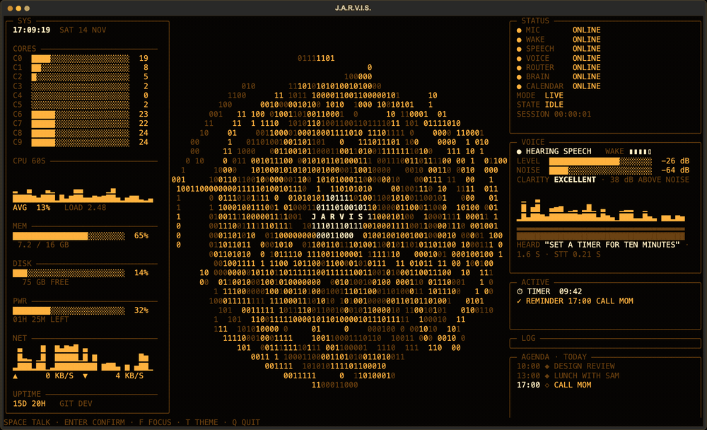
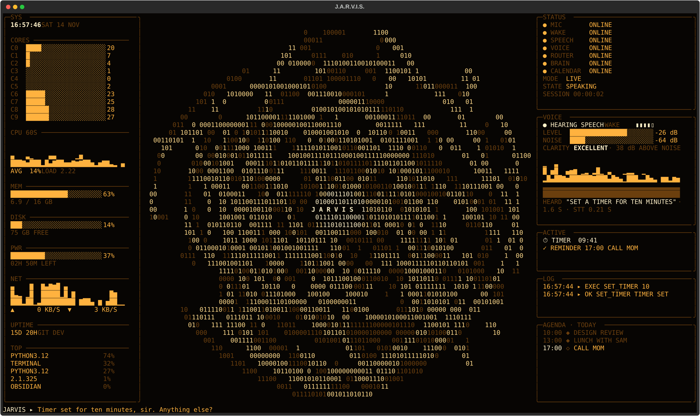
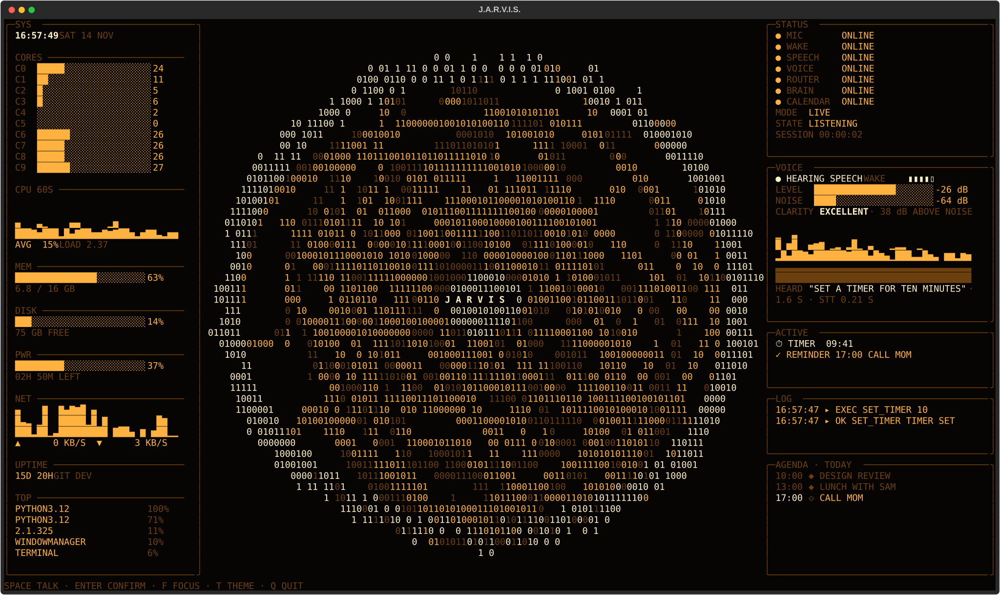
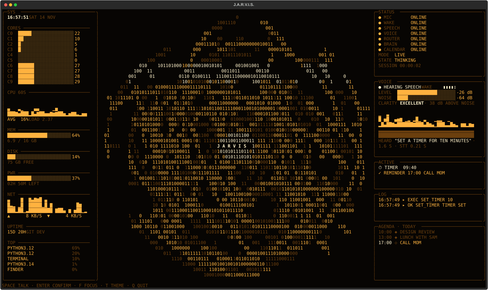
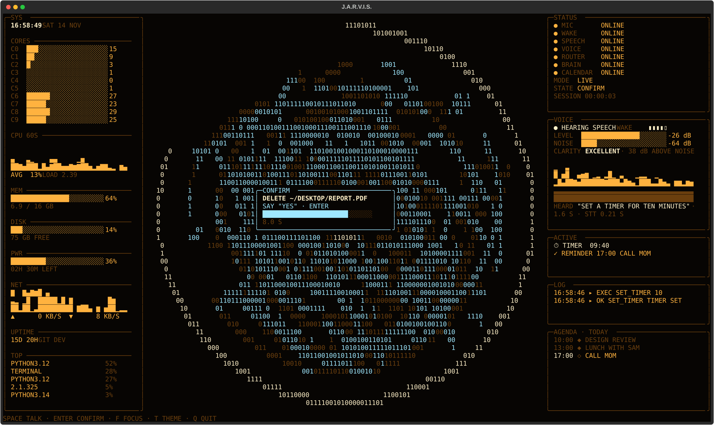
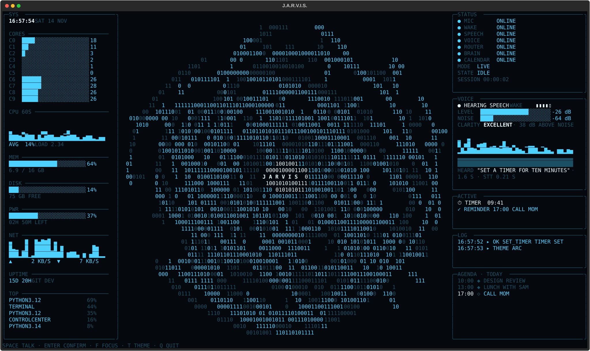
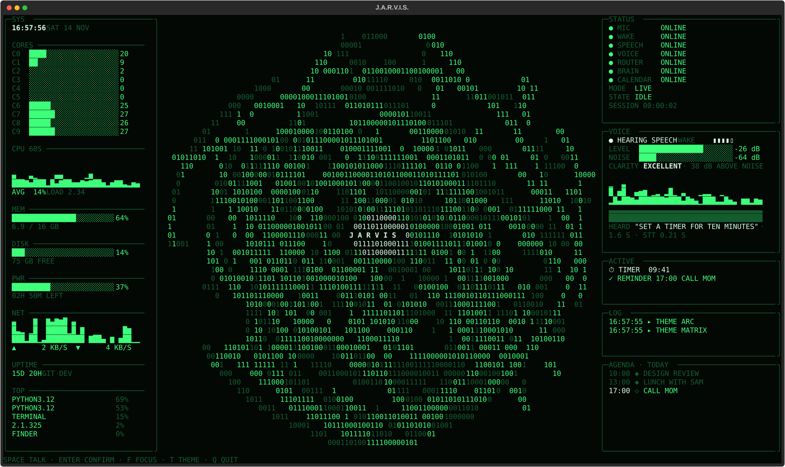
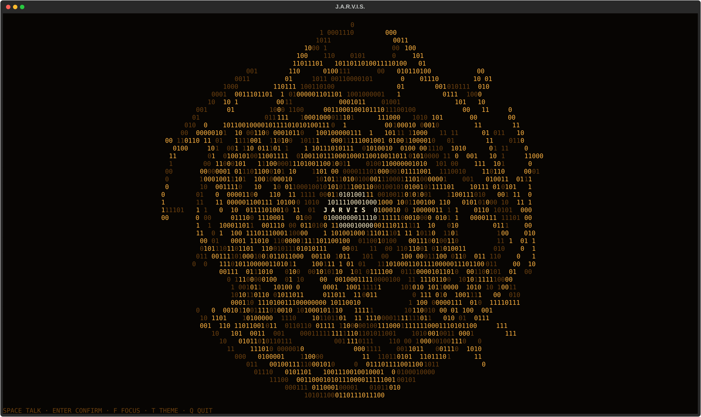
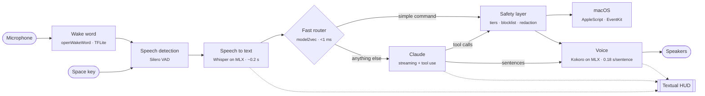
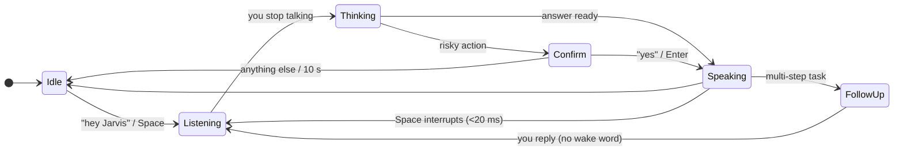

<div align="center">

# J.A.R.V.I.S. HUD

**A voice assistant that lives in your Mac's terminal.**
Say *"hey Jarvis"*, ask for anything, and watch a holographic data sphere think, listen and speak.




<sub>Idle heartbeat → "hey Jarvis" (voice ring) → thinking (scan band) → speaking (core pulses, captions type out). Rendered frame by frame from the real HUD · <a href="docs/demo/jarvis-demo.mp4">MP4</a></sub>

</div>

## What it does

| You say | Jarvis |
|---|---|
| "Hey Jarvis, open Safari" | Opens it instantly — routed on-device in **under a millisecond**, no cloud call |
| "What's on the agenda today?" | Reads today's events and reminders from Apple Calendar |
| "Plan my day" | Asks Claude, creates the events and reminders, then: *"Anything I missed?"* — you can answer without the wake word |
| "Set a timer for ten minutes" | Starts it and pins a live countdown card to the HUD |
| "What's the weather like in Tokyo?" | Any open question goes to Claude and comes back spoken, with captions |
| "Delete report.pdf on my desktop" | Stops, reads the action back and waits for **"yes"** or Enter — 10 s, then it cancels |
| "Read my SSH key" | Refuses. Secrets are off-limits by design |

## The HUD

A full-terminal heads-up display, drawn at a steady **30 fps** in about 3 ms per frame.

- **Data sphere** — eight nested shells of broken arcs rendered in shimmering 0s and 1s, drifting right at different speeds, with a **heartbeat** (lub-dub) that quickens with Jarvis's state.
- **Every state has its own motion** — listening pulls the shells in and draws a live ring of your voice's spectrum; thinking sweeps a scan band through the sphere; confirming turns it white with a ring that drains as your time runs out; errors burst the shards outward and let them settle.
- **Left rail** — clock, all 10 CPU cores, 60 s CPU and network graphs, memory, disk, battery time left, uptime, top apps.
- **Right rail** — module status lights, a **voice panel** (level, noise floor, *clarity* = how far your voice stands above the room, live spectrum, wake-word meter, exactly what it heard and how fast), active timers, the action log and today's agenda.
- **Keys** — `Space` talk/interrupt · `Enter` confirm · `F` focus mode · `T` theme · `Q` quit.



| Listening | Thinking | Confirming |
|---|---|---|
|  |  |  |

| Arc theme | Matrix theme | Focus mode |
|---|---|---|
|  |  |  |

## How it works



Everything that can run on your Mac does: wake word, speech recognition, routing and the voice. Only requests that need reasoning go to Claude.



## Safety model

Rules live in code, not in the prompt — a clever sentence can't talk Jarvis out of them.

| Tier | Actions | Behaviour |
|---|---|---|
| **Runs now** | open/quit apps, volume, brightness, music, timers, system status, agenda, create events & reminders | Executes immediately |
| **Asks first** | delete/move files, delete/reschedule events, delete reminders, shell commands, send messages | Reads the action back; needs "yes" or Enter within 10 s |
| **Never** | `sudo`, Keychain, password managers, disk erase, `~/.ssh`, `.env`, keys and tokens | Refused outright |

- **Unknown actions are blocked by default.** The model can only call actions in the registry.
- **Redaction everywhere** — anything bound for Claude, the screen, the voice or the log passes a secret filter first.
- **Shell commands are best-effort filtered** (chaining, substitution and interpreter tricks are refused) — the confirmation is the real control, so read the readback.
- **No file contents are read** in this version.

### Privacy

Speech is transcribed **on your Mac**. For questions that go to Claude, the transcript plus today's calendar titles, the time and battery level are sent to the Anthropic API. A redacted session log is kept at `logs/jarvis.log` (owner-only permissions, never committed).

## Engineering notes

Some of the problems solved along the way, each found by measuring first:

| Symptom | Root cause | Fix | Result |
|---|---|---|---|
| HUD lagging, CPU at 80–93 % | 6,600 styled spans per frame — 17 ms to draw, over the 16.7 ms budget | One span per colour run | **2.8 ms/frame** |
| Sphere and voice glitching every few seconds | Python's garbage collector walking 370k model objects — **61 ms** pauses | `gc.collect()` + `gc.freeze()` after the models load | GC passes **3 ms**, worst stall **16 ms** |
| Stutter once a second | `git` + process scan on the UI thread (33 ms) | Moved to a worker thread | p99 stall 62 → 12 ms |
| Crackle at the end of sentences | `close()` discards the audio buffer | Drain (`stop()`) before closing | Clean endings |
| Silent crash on any question | A PyObjC completion block returned a value; macOS aborted the process | Void callback + a test fake that enforces it | Calendar read in 0.10 s |
| "What's the weather?" opened Weather.app | App names matched anywhere in a sentence | App routes need a command verb | Router **93.8 %** held-out accuracy |
| Wake word never fired on Apple Silicon | openWakeWord silently fell back to a broken ONNX path | Alias `ai-edge-litert` as `tflite_runtime` | Wake model loads as TFLite |

Frame pacing is regression-tested: **30 fps, ~2 ms jitter, 0 dropped frames** in a 6 s headless run.

## Quickstart

Requires an Apple Silicon Mac, macOS 14+, and [uv](https://docs.astral.sh/uv/).

```bash
git clone https://github.com/issajber30-arch/jarvis-hud.git
cd jarvis-hud
uv venv --python 3.12 .venv
uv pip install --python .venv/bin/python -r requirements.txt
cp .env.example .env          # then paste your Anthropic API key into .env
.venv/bin/python main.py      # or: .venv/bin/python main.py --hud-only
```

On first run macOS asks your terminal for **Microphone**, **Calendars**, **Reminders** and **Automation** access. Models (~2 GB) download once. A GPU-accelerated terminal such as [Ghostty](https://ghostty.org) gives the smoothest, true-colour HUD.

`--hud-only` runs the display alone — no microphone, voice, models or API calls.

### Make it yours

- **Voice lines** — `prompts/lines.yaml` holds 8+ original lines per situation (greetings, done, failed, follow-ups…). Edit freely.
- **Persona** — `prompts/jarvis_system.md`.
- **Themes, timings, models** — `config.py`.

## Project layout

```text
main.py              app, state machine, turn orchestration
config.py            hardware, audio, model and theme settings
contracts.py         shared types and the action registry (tiers)
audio/               wake word + VAD listener, Whisper STT, Kokoro voice, chime
tools/               fast router, safe macOS controller, EventKit calendar, Claude brain, redaction
hud/                 data sphere, telemetry, voice panel, status, cards, confirm card, styles
data/                synthetic command set + precomputed router vectors
prompts/             persona and voice lines
tests/               unit, integration and performance tests
docs/                design spec, implementation plan, screenshots
```

## Development

```bash
.venv/bin/python -m pytest -q
```

Built test-first. The suite covers the router (accuracy and latency), the safety tiers and redaction, the confirmation flow, audio barge-in latency, HUD frame cost and pacing, and the full app headless.

Branches: `main` (stable) ← `dev` (integration) ← `feat/data`, `feat/tools`, `feat/audio`, `feat/hud` — the four parts were built in parallel against shared contracts, then integrated on `dev`.

## Roadmap

- Streaming speech recognition for live captions as you talk
- Wake-word training on your own voice
- Menu-bar launcher and start-at-login
- Optional local LLM for fully offline answers

## Credits

[Whisper](https://github.com/openai/whisper) via [mlx-whisper](https://github.com/ml-explore/mlx-examples) ·
[Kokoro-82M](https://huggingface.co/hexgrad/Kokoro-82M) via [mlx-audio](https://github.com/Blaizzy/mlx-audio) ·
[openWakeWord](https://github.com/dscripka/openWakeWord) ·
[Silero VAD](https://github.com/snakers4/silero-vad) ·
[model2vec](https://github.com/MinishLab/model2vec) ·
[Textual](https://github.com/Textualize/textual) ·
[Anthropic Claude](https://www.anthropic.com)

Fan project inspired by the idea of a personal AI butler. Not affiliated with or endorsed by Marvel or Disney; no film assets, logos or voices are used. The default voice is Kokoro "bm_george"; the optional voice-clone hook is for your own voice or a voice you are licensed to use.

MIT License — see [LICENSE](LICENSE).
